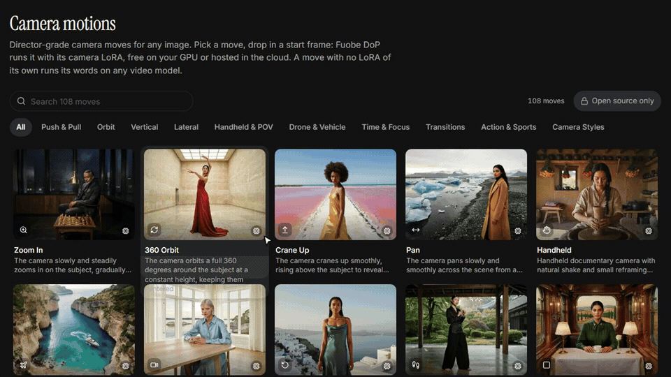
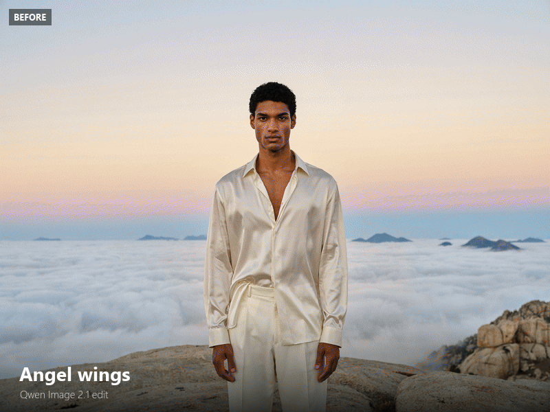
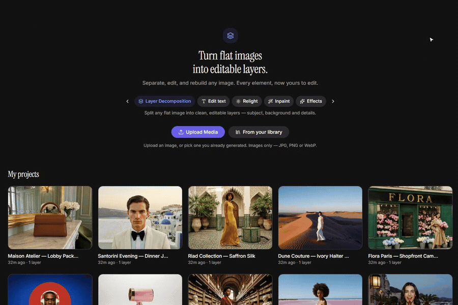
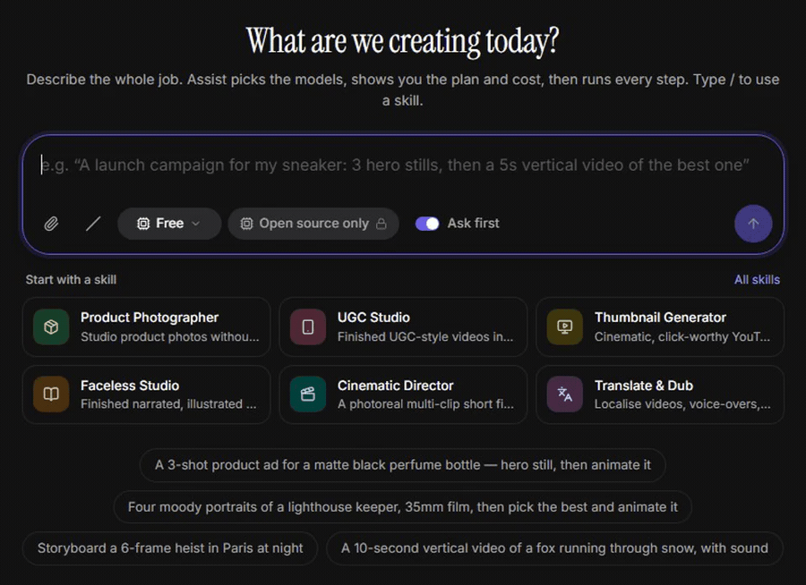

<h1 align="center">Fuobe</h1>

<p align="center">
  <b>The open creative studio on ComfyUI.</b><br>
  Images, video, 3D and audio on open weights, on your own GPU or in the cloud.
</p>

<p align="center">
  <a href="LICENSE"></a>
  <a href="https://www.comfy.org"></a>
  <a href="https://nextjs.org"></a>
  <a href="docs/FEATURES.md#model-licences"></a>
</p>

<p align="center">
  <a href="https://fuobe.com"><b>Website</b></a> &nbsp;·&nbsp;
  <a href="docs/media/fuobe-demo.mp4"><b>Demo video</b></a> &nbsp;·&nbsp;
  <a href="#documentation"><b>Docs</b></a> &nbsp;·&nbsp;
  <a href="#quick-start"><b>Quick start</b></a>
</p>

<br>

<p align="center">
  
</p>

<p align="center">
  Fuobe is a complete creative studio that you run yourself.<br>
  Use open-weight models through ComfyUI on your own GPU, or frontier models with your own fal.ai or Replicate key.<br>
  Every preview clip and still was rendered locally on ComfyUI, on one RTX 5090.
</p>

<br>

## Features

<table>
  <tr>
    <td width="50%" valign="top">
      
      <h3>Motions, effects and apps</h3>
      108 camera motions (mix any two), 255 effects and 125 apps, ready for a photo or a prompt.
    </td>
    <td width="50%" valign="top">
      
      <h3>Before and after</h3>
      Turn one photo into a new scene, look or shot with an app, an effect or an edit in plain words.
    </td>
  </tr>
  <tr>
    <td width="50%" valign="top">
      
      <h3>Layers</h3>
      Split a flat image into editable layers, then change its text, repaint an area or save a layer as an element.
    </td>
    <td width="50%" valign="top">
      
      <h3>Assist agent</h3>
      Describe the whole job in a chat. Assist shows the plan and its cost, and runs it when you approve.
    </td>
  </tr>
  <tr>
    <td width="50%" valign="top">
      
      <h3>Image to 3D</h3>
      Turn a photo, several photos or a few words into a 3D model or a Gaussian splat.
    </td>
    <td width="50%" valign="top">
      
      <h3>Your GPU or the cloud</h3>
      One switch picks open weights on ComfyUI, frontier models with your key, or both.
    </td>
  </tr>
</table>

**Also inside:** Cinema (with a Fly path through 3D scenes), Shorts, Marketing and Ads studios, Canvas node workflows, Storyboard, Turnaround video, voice and music tools (Split soundtrack takes any soundtrack apart into dialogue, music and effects), skills, MCP and a CLI. [See every feature →](docs/FEATURES.md)

## Quick start

```bash
git clone https://github.com/workingprototype/fuobe.git && cd fuobe
pnpm install
pnpm dev          # http://localhost:3000  (production: pnpm build && pnpm start)
```

Open **Settings → Engine mode** and connect what you have: a ComfyUI server, a fal.ai or Replicate key, or nothing at all. Demo mode lets you click through every tool with labelled placeholder outputs.

**Requirements:** Windows, macOS or Linux · Node 22+ · pnpm · for the open engine, a GPU running ComfyUI (24 GB of VRAM covers almost every workflow). On Windows, `start.bat` installs and starts everything for you.

## Run on ComfyUI

Choose **Open source only** and Fuobe runs every generation on open weights through your ComfyUI: 158 API-format workflows, 153 of them validated against real node definitions. `scripts/comfy/install-comfyui.sh` installs ComfyUI and its node packs at pinned commits. In Fuobe, the **ComfyUI workflows** page lists the model files each workflow needs and copies the exact install commands.

[Set up the open-source engine →](docs/SELF-HOSTING.md#the-open-source-engine-comfyui) · [ComfyUI scripts](scripts/comfy/README.md)

## Local models and cloud keys

| For | Works with | Set it in |
|---|---|---|
| Prompt help and the Assist agent | Ollama · LM Studio · Unsloth Studio · any OpenAI-compatible server | Settings → AI helper |
| Hosted image, video and audio models (optional) | fal.ai · Replicate | Settings, or `FAL_KEY` / `REPLICATE_API_TOKEN` |
| Claude in Assist and text steps (optional) | Anthropic | Settings, or `ANTHROPIC_API_KEY` |

[Every connection, step by step →](docs/SELF-HOSTING.md#engine-mode-and-connections)

## Self-hosting and security

Fuobe keeps your keys, settings and results on your machine (in `data/` by default). Before you open it to a network, set a password in **Settings → Security** (or `FUOBE_PASSWORD`). Every page and API call then needs a sign-in or an API token. Share links are the one exception.

[Security and environment variables →](docs/SELF-HOSTING.md#security) · [Public sign-up and guest browsing →](docs/public-signup.md)

### Upgrading from an earlier version

<details>
<summary>Show what changed in each update, and what to do</summary>

- **Get the new code and rebuild.** Pull `main`. On Windows, run `start.bat` as usual: it installs packages on every start and rebuilds because the code changed. On Mac or Linux, run `pnpm install`, then `pnpm build` (or just `pnpm dev`). Round 4 adds only one dependency, `@types/three` (for development; PR #9, PR #10, PR #12, PR #13, PR #14 and PR #15 add none, so `pnpm install` has nothing new for them); round 3 added `@xyflow/react`, `@google/model-viewer`, `three` and `unpdf`. The local model servers and the Image to 3D finish (below) add `@gltf-transform/core`, `@gltf-transform/extensions`, `@gltf-transform/functions`, `meshoptimizer`, `sharp` and `playwright-core`, so run `pnpm install` for them. In a checkout without `.next`, run `pnpm exec next typegen` (or a dev or build run) before `pnpm typecheck`.
- **Your data upgrades on its own.** The database migrations run once each at start-up, in order, and an existing `data/` folder (or `FUOBE_DATA_DIR`) keeps everything it holds. Round 4 adds seven migrations: one for the Library's nested folders, pins and review status (PR #6), two new tables in PR #9, `lora_mirrors` (each LoRA copy Fuobe makes) and `content_series` (Content Factory), two in PR #12: `shares` (share links; only a hash of each link's token is stored) and Assist's `assist_schedules` and `assist_connectors`, with four new columns on `assist_thread_state`, and two in PR #13: `swap_projects` (one document per Character Swap Studio project) and the O7 cleanup, which deletes the saved Higgsfield key, turns "Higgsfield first" into Automatic and marks the ads Higgsfield drew `baked`. They are added at the first start. PR #12's and `swap_projects` only add tables and columns, but the O7 cleanup can't be undone, so back up `data/` (or `FUOBE_DATA_DIR`) first if you might go back to an earlier version. PR #7, PR #10 and PR #14 add none (still 23 migrations). Since PR #14, main's GPU pre-flight (`gpu_snapshots` and `gpu_audit`) and public sign-up's file owners (`assets.account_id`) add two more, and PR #15 adds none (25 migrations). Settings → Models & licences keeps its switches in the existing settings table (`models.access`), Soul ID uses the existing trainings table, and since PR #14 a skill's recipe lives with its other files in the skills table. The list is in [`docs/ARCHITECTURE.md`](docs/ARCHITECTURE.md#storage-srcserverdbts-storagets-settingsts).
- **Canvases are saved in a new form (PR #10).** A board is rewritten with pages the next time it is saved, and older Fuobe builds can't read it after that. Back up the data folder if you might go back to an earlier version. Scripts that read a canvas through the API: `GET /api/canvases/:id` now returns `canvas.pages` (each page with its graph), not `canvas.graph`.
- **If you ran one of the round-3 package branches** (`r3/*`, `r3b/*`) before they were merged, start with a fresh data folder. Those branches numbered their migrations differently, so tables can be missing. Move the old folder aside rather than deleting it if it holds results you want. A folder used by the `r4/assist-connectors` branch before its review fixes needs the same: its migration changed in place. The same goes for a folder used by the `r4/content-factory` branch on its own: there Content Factory's table took the Library migration's number, so the Library's folders, pins and review status would never be added.
- **If your data folder ran the old PR #15 branch** (`claude/fuobe-parity-4` up to `f7c6d8e`, or `claude/fuobe-r5-batch-7` up to `c9cd489`), back it up first. That branch used places 23 and 24 of the migration list for its accounts packages (identity tables and an audit-log trigger), which the owner later dropped, so main's two migrations in those places would be skipped. Since PR #15 the first start repairs such a folder and runs main's two (the GPU pre-flight's tables and `assets.account_id`). The old accounts tables, `data/secret.key` and `data/backups/` stay, unused. Sign-in goes back to `data/auth.json`, so a password or token changed on that branch is lost, and its `FUOBE_MODE`, `FUOBE_SIGNIN`, `FUOBE_SECRET`, `FUOBE_OWNER_PASSWORD` and `FUOBE_TRUSTED_PROXIES` are ignored (main reads `FUOBE_PASSWORD` and `FUOBE_TRUST_PROXY`).
- **Start on Home now runs the job** in Image, Video or Edit instead of only opening the studio. With a saved key for the default model this is a paid run; the line under the box says first what will run and what it costs. **⌘K / Ctrl+K** opens the search palette instead of going Home.
- **Topaz Video is priced by size:** $0.01/s at 720p, $0.02/s at 1080p and $0.06/s above, doubled at 60 fps (it was a flat $0.02/s at 2×). The default target is 1080p, and a size that wouldn't enlarge the clip moves up, so a 1080p clip now goes to 1440p at $0.06/s. Open-source video upscaling (SeedVR2, Real-ESRGAN) also asks for a size now, 720p to 2160p, instead of 2× or 4×.
- **Cloud Mixed Media costs more by default.** It now redraws each sampled frame (**Per frame**): about $6 for 10 s at 1K, where the video-to-video pass was one call. Pick **Fast** under Restyle to keep the old behaviour. API calls with no `modelId` and no `mode` now get Per frame; a model sent for the wrong mode gets a 422.
- **Click to Ad ends on a logo card by default** when the product kit has a logo: 2.5 s longer, included in the price. Switch **End card** off to keep the old ads. API calls without `endCard` are unchanged.
- **Motion and effect links open on the move's model (PR #10).** Picking a camera motion or effect in the Video studio, or arriving from Motions or Effects, now switches to the model its move runs on: Fuobe DoP or Fuobe DoP · LTX, a few on LTX-2.5. In the cloud, 152 presets change model and price; the other 211 keep Kling 2.5 Turbo as their route and leave the model you picked alone. Moodboards' curated looks open on Fuobe Soul. Per-megapixel cloud prices (Z-Image Turbo, Qwen-Image 2512, FLUX.1 Fill [pro]…) now count every picture, so n pictures quote about n× the old estimate. On a Canvas board, dragging the empty board now draws a selection box; scroll, Space-drag, the middle button or H pans.
- **Open-engine motions and effects no longer all run on Wan 2.2 (PR #10).** 17 open on Fuobe DoP · LTX (FPV Drone, Wind to Face, Earth Zoom Out, Flying Cam Transition and 13 transitions) and need the LTX-2.3 checkpoint (29.53 GB, plus the 9.45 GB Gemma 3 text encoder if LTX-2 isn't set up) and a 32 GB GPU. On 24 GB, pick Fuobe DoP: it runs their words. Slow Motion, Car Drive and Wild Ride open on LTX-2.5. Relight effects first run the existing Qwen-Image-Edit 2509 Relight workflow (about 31 GB of model files).
- **Cloud keys for the Originals (PR #10).** The presets that moved to Fuobe DoP, Fuobe Soul HD, the relight step and Focus Change need a fal key; Fuobe DoP (start frame only) and Fuobe Soul's text to image also run on Replicate. None runs on Higgsfield: with only a Higgsfield key, motion links and curated looks opened on a model that couldn't run. Since PR #13 a Higgsfield key does nothing, so add a fal key (see the O7 note below).
- **Licences are information, not gates (PR #12).** Everything is switched on by default: LoRAs licensed for your GPU only (civitai files without the "Rent" permission) now go to fal or Replicate with a note, Assist and automatic picks can choose non-commercial models, and re-running the install script adds the non-commercial ComfyUI-Whisper. Studio defaults don't change with it. To stay commercial-only, or keep GPU-only LoRAs at home, use **Settings → Models & licences**: switch off licence classes, providers, node packs, LoRAs or models, and turn on **Keep them on your GPU**. There is no admin role: anyone who can sign in (or anyone who can reach a password-less install) can change it.
- **MiniMax H3 (PR #12)** is Character swap's default on both engines and runs H3 Person Removal. Its licence excludes the US, the EU, the UK and South Korea, needs MiniMax's written authorization above US$20M yearly revenue, and asks commercial products to show "MiniMax H3". If that doesn't fit, switch off "Fuobe Character swap", "H3 Character Swap · Relay 2.0" and "H3 Person Removal · Relay 2.0" in Settings → Models & licences. The Restricted regions switch covers only your GPU, because fal's H3 is classed as a paid API.
- **Share links skip sign-in (PR #12).** Nothing is shared until you make a link. Set `FUOBE_PASSWORD` so the rest of the studio stays locked (the Share dialog warns when there is none), and behind a reverse proxy set `FUOBE_TRUST_PROXY=1` so a visitor who guesses wrong links is locked out alone. Copy a link when you make it: only the browser that made it can copy it again. Revoking a link deletes it at once, though a browser may keep files it already fetched for 5 minutes.
- **Scheduled tasks (PR #12)** run only while Fuobe runs; a run missed while it was off happens once after the next start. A sweep every 30 s starts at boot, and every Fuobe server on the same database runs due tasks, so a dev server on your real data folder runs, and spends on, your schedules too. A task asks first by default; one that runs on its own counts Fuobe's generation jobs against its cap, not Claude's tokens. Connectors are offered in every Claude chat, the ones you already have included; a scheduled task uses them only when you tick "Let runs use my connectors".
- **New defaults in Cinema, Genjutsu and Soul ID (PR #12).** Cinema's video default is Fuobe Cinema on both engines, so a cloud take costs LTX-2.3's price per megapixel of video on fal (about $0.18 for 5 s at 720p), and stills default to Fuobe Soul Cinema. Cinema Studio 4.0, Soul 2.0 and Higgsfield's Soul Cinema leave Cinema's menus, and a saved pick falls back to the Original. Genjutsu's modes (all but Insert) default to the Fuobe Originals instead of Higgsfield's Genjutsu; old setup codes open the replacing Original (without a Higgsfield look), and Katana's Genjutsu motion option takes 1 reference instead of Higgsfield's 8. In the cloud, Fuobe Cinema and the Genjutsu Originals need a fal key. Soul ID no longer trains on Higgsfield: a Higgsfield training still queued or running fails with a note to retrain for Fuobe Soul. fal's Z-Image training is now 2,000 steps for about $1.70 (it was 1,000 for $0.85), elements hold up to 80 photos (was 20), and Photodump, Fashion and trained moodboards run on Fuobe Soul.
- **Scripts that call the API (PR #12):** training a character needs `consent: true` (`POST /api/elements/[id]/trainings` takes `{target, consent}`), `/lora` takes `family` instead of `modelId` and `/training-kit` a `family`; `POST /api/genjutsu` takes mode `character`, and look kind `soul` replaces `higgsfield`; Cinema's `GET /api/cinema/projects/[id]` returns `context` as `{cloudAllowed, civitai}` (no `higgsfield`); `GET /api/models` lists only models that are on, and `POST /api/generations` answers 422, naming the switch, for one that is off.
- **Higgsfield is no longer called (O7, PR #13).** The saved Higgsfield key is deleted, and **Preferred provider** goes back to Automatic if it was "Higgsfield first" (its choices are now Automatic, fal.ai first and Replicate first). Remove `HIGGSFIELD_API_KEY` and its aliases `HF_KEY`, `HF_API_KEY` and `HF_API_SECRET` (Higgsfield's, not Hugging Face's) from `.env`: they are no longer read, and `FUOBE_CLOUD_PROVIDER=higgsfield` counts as `auto`. If Higgsfield was your only cloud key, add a fal.ai (or Replicate) key; until then, cloud runs come back as demos (with Demo mode on Auto). Reuse, saved Canvas boards and Cinema projects, Genjutsu setup codes, Katana jobs, Assist plans, retries and API, CLI or MCP calls that name Soul, Soul 2.0, Soul Cinema, Cinema Studio 4.0 or a Genjutsu model run on the Fuobe Original that replaced it, on your engine (Marketing Studio Image ran on GPT Image 2.5, and Ads Studio and the AI Influencer app on Nano Banana Pro, until their Originals landed in PR #14: see below), and the API's notes say so. In an API, CLI or MCP call and a retry, Cinema Studio's Director settings become words in the prompt (Reuse leaves them out and says so), and its reference takes run on Seedance 2.5. Seedance 2.5's video edit and LTX 2.5's start/end-frame clip only ran there: they now run on Kling O3 and Fuobe Cinema. Past results stay in the Library under the name they ran as ("Soul 2.0 (Higgsfield)"). A job still running there when you upgrade fails on its next check with a note to run it again, a Higgsfield Soul ID training still queued or running fails with a note to retrain for Fuobe Soul, and an Ads Studio batch made there is remade the Fuobe way on retry. Switches you set in Settings → Models & licences on a retired model or on the Higgsfield provider no longer apply to anything: if you had switched off, say, Soul 2.0, switch off its replacement too.
- **Other O7 changes (PR #13).** Happy Horse 1.1 (text, image and reference to video) now runs with a fal key: $0.14/s at 720p, $0.18/s at 1080p. The Ad Multiplier's cloud choices are Kling O3 edit (the default) and Happy Horse video edit, which keep the ad's sound but recreate at most its first 15 s (a longer selection is cut, with a note), and Gemini Omni Flash. Character Sheet → Build from scratch in the cloud runs on Fuobe Soul in Cinema's casting look (Nano Banana Pro if that is switched off); it used Soul 2.0 or Nano Banana Pro, so its price and look change. The AI Influencer app used Nano Banana Pro in the cloud, and the GPU path was unchanged (since PR #14 both draw in Fuobe Soul's Realistic look: Fuobe Soul in the cloud, the Soul Cast sheet on your GPU). Grok Imagine Image 2.0 takes 5 references (was 10). Old Higgsfield Soul IDs are labelled "Older Soul ID". If you installed Fuobe's skills into another agent (Cursor, Codex…), re-run `npx skills add workingprototype/Fuobe`: four playbooks now name other models.
- **Scripts that call the API (PR #13):** `GET /api/providers/higgsfield/presets` is gone; `POST /api/providers/test` with `higgsfield` answers 400, `GET /api/status` no longer lists it, and `PUT /api/settings` ignores `higgsfieldKey` and refuses `cloudProvider: "higgsfield"` (400). `POST /api/generations` may answer with a replacement `modelId` and `notes` saying what changed. Ads batch and estimate bodies and `POST /api/brands/[id]/chat/confirm` ignore `route` and `ratio`, and `/api/ads/estimate` no longer returns `route`. `POST /api/uploads` also takes MKV and AVI (200 MB as before): the Character Swap Studio's picker lists them, other pickers still list MP4, MOV and WebM, and browsers can't play AVI. The Character Swap Studio's routes are new, under `/api/swap-studio/projects`.
- **Character Swap Studio on your GPU (PR #13)** needs the H3 Relay 2.0 node pack (`akatz-ai/h3-relay` at `e2a7665`): re-run `scripts/comfy/install-comfyui.sh` with `H3_RELAY=1`, or on Windows or ComfyUI Desktop clone it into `custom_nodes` and check out that commit. It also needs VideoHelperSuite and FFmpeg on the ComfyUI machine, a 24 GB GPU with offloading and 64–128 GB of RAM (48 GB+ advised for 768p), and ComfyUI started with a higher `--max-upload-size` (100 MB by default) for continuations with more than about 30 frames of history at 1 MP; an upload ComfyUI refuses as too large now says so. It adds no model files: it uses PR #12's MiniMax H3 files. In the cloud it needs a fal key. MiniMax H3's licence (above) applies to it too. Its swap runs on "Fuobe Character swap" in the cloud and on "H3 Character Swap · studio segment" on your GPU (listed in Settings → Models & licences as a helper step studios run), and it refuses only what is switched off there: if H3's licence doesn't fit, switch off that second one too. A sweep every 3 s, from server start, starts takes that were waiting on the one before; like scheduled tasks, it runs in every Fuobe server on the same data folder, so a dev server on your real data can launch (and pay for) them too.
- **A busy ComfyUI no longer counts as down (PR #13).** Before, one 1.5–2 s check decided, so a ComfyUI busy with a job could send new runs to demo. Now it counts as up if it answered in the last 2 minutes, or if its port accepts a connection and it answers a longer 10 s check. A refused connection, an unknown host or an HTTP error still means down at once; a port that accepts connections but never answers (a hung ComfyUI, a tunnel to a dead box) is down after the 10 s check. A chain step after real ComfyUI steps (such as the Canvas concatenator's join) waits up to 60 s for ComfyUI before failing; cloud steps don't wait. The local was unchanged until PR #14 (below).
- **New defaults and prices (PR #14).** Marketing Studio, Ads Studio, the AI Influencer builder and app, Photodump, Fashion Factory, Mixed Media, Shorts, cloud Storyboard boards and DoP's 32 Mixed Media effects now start on Fuobe Originals or hosted open models, so their results and prices change; the partner models stay as choices. None of these defaults has been measured by the evaluation harness yet. Lipsync prices talking avatars on the voice's length, not 5 s (Fuobe Speak with a 12 s voice: $2.40). Edit video prices the edits that keep the clip's length (Happy Horse, Runway Aleph 2, Lucy Edit Pro, Kling O3 4K edit, Gemini Omni Flash, Grok Imagine edit) on the clip's seconds, not a flat 5 s, and refuses a clip outside a model's window, in the app and the API: Happy Horse and Kling O3 4K edit 3–15 s, Runway Aleph 2 2–30 s, Wan 2.7 2–10 s, Gemini Omni Flash up to 10 s. Happy Horse video edit shows half its old price: $0.28 per second of clip at 720p, $0.56 at 1080p (Fuobe counted each second twice; fal's bill was not doubled). Cloud PixeletedFace adds $0.01 a picture for its face mosaic, and InfiniteTalk Long on your GPU runs up to 40 s (was 20 s) and refuses longer voices.
- **Retries and API scripts (PR #14).** Retrying a run stored as `marketing-studio-image` or `ads-studio` lands on Fuobe Marketing Image, and `ai-influencer` on Fuobe Soul, at their prices. Cloud boards use the open models unless the body sends `partner: "nano-banana-pro"`, and `oss-wan22-vace-restyle` on your GPU now runs Fuobe Shorts. `POST /api/generations` drops `skill`, `demo` and `asked` from its input (the server sets them), and a PixeletedFace picture comes back as two rows, the mosaic first. New routes: `/api/evolution` (with `/estimate` and `/direction`), `/api/storyboards/estimate`, `/api/influencer/estimate`, and for skills `/api/assist/skills/[name]/recipe`, `/estimate`, `/run` and `/verify` (its paid `real` level is API only and needs `confirm: true`) and `/api/assist/skills/draft` (with `/check`, `/name` and `/save`); `GET /api/assist/skills/[name]/download?format=zip` gives a skill with its files.
- **A user skill named `draft`?** Rename it before you upgrade: the skill builder now owns that address, so Fuobe can't open, edit, rename or delete a skill with that name afterwards (read from the code, not tested). Files a skill's recipe names now count as in use, so Empty trash keeps them, and an uploaded `recipe.json` loses its checks and has to be checked again on your install.
- **The new Originals on your GPU (PR #14).** Set a LoRA folder in Settings → LoRAs so Fuobe can fetch the new LoRAs; six Mixed Media looks need a civitai key for theirs. Without a LoRA folder, Mixed Media leaves a missing look LoRA out with a note, but DoP's Mixed Media stills for the 14 looks with a LoRA fail when they're sent. Evolution, Fuobe Angles, Fuobe Shorts and Smooth need 24 GB of VRAM; Mixed Media per frame and Fuobe Speak 16 GB (the manifest's figures, not measured). In the cloud, the new Originals need a fal key; Replicate also serves Fuobe Marketing Image's edits.
- **Ollama, busy or down (PR #14).** Ollama now follows ComfyUI's rule: one that answered in the last 2 minutes, or whose port takes a connection and answers a longer 10 s check, counts as up, so a busy Ollama no longer sends Assist to the offline planner. Opening Assist waits at most 1.5 s for an Ollama that never answers.
- **AI-Toolkit in Settings (PR #14).** **Settings → Training · AI-Toolkit** holds the address, an optional token and the photos folder, which must be a full path, each with Save & test; it is greyed out in Paid APIs only mode. The Train dialogs' "Open Settings" goes to the section that clears their blocker.
- **Settings → Prompt enhancement is now AI helper.** Besides Claude and Ollama it talks to LM Studio, Unsloth Studio and any other OpenAI-compatible server (see the table above). Nothing needs changing: `FUOBE_ENHANCE_PROVIDER=ollama` and a saved Ollama choice now mean "a local model", the Ollama settings and environment variables are read as before, and Assist chats saved on Ollama open on the local model. With Automatic, Fuobe uses the first local server that answers with a model (Ollama first); pin one with `FUOBE_LLM_PROVIDER`. A model LM Studio loads for Fuobe gets 16k of context (`FUOBE_LLM_CONTEXT`).
- **Image to 3D on your GPU: Pixal3D and the finish.** From an image now runs Pixal3D by default (`image-to-3d-pixal3d`: MoGe 2 estimates the camera, about 250k triangles); TRELLIS.2 stays in the menu. It needs one new model file, Pixal3D's single-view weights (`pixal3d_int8_convrot`, 5.58 GB; the multi-view graph uses its own), plus MoGe 2 and the files TRELLIS.2 already uses; the Workflows page lists them. Like TRELLIS.2, it encodes with DINOv3, so its results show "Built with DINOv3". Before a job shows as done, the server makes a web copy of each open-engine GLB (meshopt geometry, WebP textures, the pivot at the bottom); the raw GLB stays the download. After it, the server renders a 4 s turntable on the CPU, one at a time, when ffmpeg and a Playwright Chromium are there (`npx playwright-core install chromium-headless-shell`); without them the 3D page records one in your browser.
- **LoRAs on the open engine:** set the **LoRA folder** in Settings → LoRAs, plus a civitai key for 72 of the 118 library LoRAs. Fuobe writes the files itself, so the folder must be one the Fuobe machine can write to (ComfyUI on the same PC, or its `models/loras` shared); otherwise place the files by hand, as you must for the two gated Hugging Face LoRAs. With no folder set, a run that needs a LoRA ComfyUI doesn't have stops and says what to do. A LoRA sent to a workflow with no model loader to attach it to now fails the run instead of being dropped silently. Since PR #10 the presets use many more LoRAs on the open engine: 84 files (was 43), 36 of them from civitai (was none). Without the civitai key, a motion, an effect or one of six Cinema Studio moves (Handheld, POV, Robot Arm, Snorricam, Tracking and Side Tracking) that needs a civitai file ComfyUI doesn't have stops before the job; Fuobe Soul leaves those LoRAs out and says so.
- **Cloud runs with LoRAs:** when a model runs on both fal and Replicate, Fuobe picks the one that can take every LoRA and the clip length asked, even over **Preferred provider**. LoRAs a run can't take are left out with a warning.
- **Password-less installs reached by a domain name** (a reverse proxy, a tunnel, a Tailscale name) get 403 since round 3. Set a password, or add the name to `FUOBE_ALLOWED_ORIGINS`.
- **Inputs from LAN addresses** (an image URL on your NAS, say) are refused unless `FUOBE_ALLOW_PRIVATE_URLS=1` (also since round 3).
- **ComfyUI node packs:** re-run `scripts/comfy/install-comfyui.sh` (it keeps what's installed and pins each pack to the commit Fuobe was validated with). Round 3 added ComfyUI-MelBandRoFormer, ComfyUI-QwenASR and ComfyUI-HunyuanVideo-Foley; round 4 adds ComfyUI-ToSVG for the open Vectorize app (PR #9 and PR #10 add none). Open-source video upscaling and FPS Boost now also need ComfyUI-VideoHelperSuite (before, core ComfyUI was enough), which the script installs too. Since PR #12 the script also installs the non-commercial ComfyUI-Whisper by default (`NC_PACKS=0` leaves it out) and Akatz Labs' GPL-3.0 `h3_character_swap` pack for Genjutsu's Character swap (`H3_PACK=0` leaves it out; it needs `ffmpeg` and `ffprobe` on PATH). H3 Relay 2.0, for H3 Person Removal and the Relay swap, adds its own HTTP routes to ComfyUI, so it is opt-in: `H3_RELAY=1` (or install it on the isolated worker). PR #13 adds no pack: the Character Swap Studio's GPU graphs use H3 Relay 2.0 and VideoHelperSuite. PR #14 adds none either. Until PR #14, Workflows → **Copy install commands** gave `git clone …/tree/<commit>/…` lines for the two H3 packs, which git can't clone; now it clones H3 Relay and checks out its pinned commit, copies `h3_character_swap` out of a sparse checkout at its pinned commit, and can be pasted twice (an older `h3_character_swap` copy already there isn't updated, by these commands or by the script). PR #15 adds ComfyUI-DBS for Split soundtrack (below), and **Copy install commands** now makes a file's subfolder first (DBS's files sit in `models/dbs/<model>/`). If you set up ComfyUI another way (ComfyUI Desktop, for example, or on Windows), install these packs yourself. ComfyUI itself needs no upgrade: the library still targets 0.41.0.
- **Models for the new tools.** Round 4 adds about 28 GB of model files to the library in PR #6 (PR #7 adds none): VOID with its CogVideoX VAE (22.73 GB, Remove object's "Shadows and reflections too"), MoGe 2 (0.66 GB, 3D scenes, and since PR #10 multi-view 3D too), OvisOCR3 (1.71 GB, Layers' text detection since PR #9) and TripoSplat (Image to 3D's Splat mode since PR #10). PR #10 adds about 35 GB more, both optional: the LTX-2.3 22B distilled checkpoint (29.53 GB, plus the Gemma 3 text encoder, 9.45 GB, if LTX-2 isn't set up) for Fuobe DoP · LTX, and Pixal3D multi-view (5.58 GB, plus MoGe 2 if the 3D scene isn't set up) for TRELLIS.2 Multi-view. Fuobe Soul's image to image and the Canvas Video concatenator need no new files. The new tools also use files the library already listed, which you may not have downloaded: Wan 2.1 VACE 14B (34.68 GB) and SAM 3.1 (Remove object; Genjutsu's swap and insert), Wan Animate 2 (Genjutsu's motion transfer), Qwen-Image-Edit 2511 with the Multiple-Angles LoRA (3D scenes) and RIFE 4.26 (FPS Boost). PR #9 adds no files to the library, but its tools use these: OvisOCR3 for Layers' text detection; Gemma 4 E4B (9.06 GB) plus ComfyUI-VideoHelperSuite for Content Factory's reading of a reference clip; FLUX.1 Fill [dev] (23.8 GB) for Layers' Inpaint. The **Workflows** page lists them with their install commands. GPU memory, from the manifest and not measured: Wan VACE 24 GB, VOID 24–40 GB, SeedVR2 in passes 16 GB, Gemma 4 E4B 12 GB, OvisOCR3 3 GB; since PR #10, LTX-2.3 22B 32 GB, TRELLIS.2 Multi-view 16 GB, Z-Image Turbo image to image 12 GB.
- **Models for Character swap (PR #12).** About 45 GB of new model files, all optional and pinned: MiniMax H3's INT8 model (20.97 GB), its NVFP4 Qwen3-VL 32B text encoder (15.69 GB), H3's video and audio VAEs (5.21 and 0.61 GB), lightx2v's FL2V Turbo 8-step LoRA (1.96 GB) and Akatz Labs' swap or person-remover LoRAs (0.16 GB each), plus SAM 3.1, which the library already listed. Fuobe downloads the LoRAs into your LoRA folder before a run. They serve Genjutsu's Character swap and Remove object's H3 Person Removal on your GPU; the Workflows page lists them. GPU memory, Fuobe's advice and not measured: 24 GB of VRAM with offloading and 64–128 GB of RAM, and 48 GB+ for 768p, Character swap's default. Fuobe Cinema on your GPU needs no new files (it uses the Wan 2.2 14B Lightning graphs already in the library), and AI-Toolkit downloads Soul ID's base weights itself. The Character Swap Studio (PR #13) adds none either: its two graphs use these files and SAM 3.1.
- **Models for PR #14.** Two new files, both LoRAs Fuobe downloads into your LoRA folder: dx8152's Multiple-angles LoRA for Fuobe Angles (0.24 GB) and the optional FusioniX LoRA for Fuobe Speak (0.37 GB). The four new graphs otherwise use files the library already lists, which you may not have downloaded: Evolution the Wan 2.2 Fun VACE set (45.49 GB), Fuobe Angles Qwen-Image-Edit 2509 with its text encoder and the Lightning LoRA (31.15 GB with the new LoRA), the face mosaic SAM 3.1 (1.75 GB). Video Depth Anything large downloads about 1.5 GB on its first run. Fuobe Mixed Media, Fuobe Shorts, Fuobe Marketing Image, Fuobe Try-On and Popcorn run graphs that were already in the library (Try-On's LoRA is in Settings → LoRAs as an adapter). GPU memory, from the manifest and not measured: Evolution and Fuobe Angles 24 GB, Fuobe Speak 16 GB, Video Depth Anything large 8 GB, the face mosaic 4 GB.
- **New tools and prices (PR #15).** Split soundtrack (Audio → Split soundtrack) runs only on the open engine, on your ComfyUI (GPU or CPU): DBS isn't hosted on fal or Replicate, so the cloud engine says so and offers "Use open source". MOSS-Image (Image studio), the fly path (Cinema's 3D scene) and the turnaround video run on both engines; see [Features](docs/FEATURES.md). MiniMax H3 Max is now priced by resolution: $0.05, $0.08 and $0.16 per second at 480P, 768P and 1080P, and $0.32 at 2K (extend only), not a flat $0.0325/s; until 2026-10-31 its image and text to video quote the list price, above fal's launch price. A launch price is read on the day: a run is priced on the day it is planned, and a page shows that day's price once it loads (pages built by `pnpm build` show none until then), so a server started before FLUX 3 Max's launch price ends (2026-11-07) no longer keeps quoting it. Canvas node prices now count LoRAs (a Fuobe Soul node with look LoRAs showed $0.005/MP for a $0.0085/MP run). A clip that already has sound (Sound for video, a mux, Lipsync, Trim, Captions) offers **Split soundtrack** as a next step instead of Add sound, and the Image studio's controls chip reads **Options** instead of "Director".
- **Scripts that call the API (PR #15):** new routes `POST /api/turnaround` (`?preview=1` plans and prices), `POST /api/turnaround/estimate` and `POST /api/audio-tools/export` (Export mix, sent in 16 MB parts, up to 2 GiB); `POST /api/audio-tools` gains `split` (open engine) and `remux`, and `POST /api/cinema/projects/[id]/generate` the actions `path` and `turnaround`. In `GET /api/models`, `price` is now the day's price, and a launch-priced item gains `launch` (`until`, `price`).
- **Split soundtrack on your ComfyUI (PR #15)** needs the ComfyUI-DBS node pack (`hiroki-abe-58/ComfyUI-DBS` at `f656e53`, MIT) and four DBS files (23 MB). On Mac or Linux, re-run `scripts/comfy/install-comfyui.sh`: it installs the pack and fetches the files, checked against their SHA-256 (a mismatch only warns; `DBS_WEIGHTS=0` skips the files, but then Split soundtrack can't run). On Windows or ComfyUI Desktop, clone the pack into `custom_nodes` and check out that commit, then put `config.json` and `model.safetensors` from `JusperLee/DBS-BSRNN-DnR` and `JusperLee/DBS-TIGER-DnR` into `models/dbs/<that name>/` (the Workflows page's "Split a soundtrack" card lists them). It runs on a CPU too. The Comfy Registry flags the pack's only version without giving a reason; its code was read at the pinned commit.
- **Models for PR #15.** MOSS-Image needs about 13 GB of new files (its int8 model, 5.41 GB; the Qwen3.5 9B w4a8 text encoder, 7.34 GB; the small FLUX.2 decoder, 0.25 GB), plus 5.41 GB for its optional Fast setting. The fly path needs 18.4 GB of new files (Wan 2.1 I2V 14B 720P, 16.4 GB, and the Uni3C model, 2 GB), with a 16.64 GB 480P file as an optional drop-in. Both use only nodes built into the ComfyUI version Fuobe pins (unchanged), so an older ComfyUI may not run them. MOSS-Image's int8 and w4a8 files run on kernels that need a PyTorch built for CUDA 13 (cu130); without it ComfyUI logs a warning and probably runs slower (untested). The turnaround adds no files: it uses Frames mode's Wan 2.2 14B graphs and the Angles app's Qwen-Image-Edit 2511 with the Multiple-Angles LoRA. The Workflows page lists every file. GPU memory, not measured: the fly path about 48 GB (the library's highest; Uni3C's own figures are 46–51 GB with offloading), MOSS-Image 16 GB (a guess), the turnaround about 24 GB; DBS runs on a CPU.
- **`pnpm test` also runs the evaluation harness's Python metric tests**, in the harness's own venv or through uv (which may download numpy, Pillow and pytest once); with neither, they are skipped. Nothing is removed in PR #9 or PR #10: no route, setting, environment variable, workflow or provider. PR #10 adds no setting or environment variable either, and `pnpm gen:catalog` now also writes Fuobe Soul's looks. PR #12 removes no route, environment variable, workflow or provider either, and adds no app environment variable (its new settings are Settings → Models & licences and Assist's connectors); the install script gains `H3_PACK` (default 1) and `H3_RELAY` (default 0), and `NC_PACKS` now defaults to 1. `pnpm gen:catalog` also runs `scripts/gen-trainers.py`, and the LoRA and Soul generators print licence notes instead of stopping. PR #13 removes the Higgsfield provider: the `higgsfieldKey` setting with its environment variables, the `higgsfield` Preferred provider value and `GET /api/providers/higgsfield/presets`. It adds no setting or environment variable, `pnpm gen:catalog` runs `scripts/gen-studio-packs.py` instead of the two Higgsfield generators, and `pnpm build` no longer prints the 4 Turbopack tracing warnings. PR #14 removes no route, setting, environment variable, workflow or provider, and adds no setting or environment variable either: Settings → Training puts the existing `AI_TOOLKIT_*` settings on the page, and Settings → LoRAs gains the adapters group. PR #15 removes no route, setting, environment variable, workflow or provider, and adds no setting or app environment variable: Settings → Models & licences gains a switch for each new model and for ComfyUI-DBS, and the install script gains `DBS_WEIGHTS` (default 1).

</details>

## Development

```bash
pnpm typecheck && pnpm lint && pnpm test
```

Browser checks, catalog generation, the evaluation harness and the project layout are in [docs/DEVELOPMENT.md](docs/DEVELOPMENT.md). Issues and pull requests are welcome: see [Contributing](docs/DEVELOPMENT.md#contributing).

## Documentation

| Guide | What it covers |
|---|---|
| [Features](docs/FEATURES.md) | Every studio, tool and Fuobe Original, in detail |
| [Setup and self-hosting](docs/SELF-HOSTING.md) | Engine modes, keys, local models, security, environment variables, ComfyUI |
| [Command line](docs/cli.md) | The `fuobe` CLI, plus MCP and skills for other agents |
| [Architecture](docs/ARCHITECTURE.md) | How a request flows from the composer to the providers and back |
| [Development](docs/DEVELOPMENT.md) | Tests, browser checks, the evaluation harness, project layout |
| [Status](docs/STATUS.md) | What works, what is verified and what is left (also in the app at `/status`) |

## License

Fuobe's code is [MIT licensed](LICENSE). Model weights, LoRAs and ComfyUI node packs have their own licences: **Settings → Models & licences** shows each one with a switch, and [Model licences](docs/FEATURES.md#model-licences) lists the ones to check before commercial use.

<br>

<p align="center">
  <sub>Every preview rendered locally on ComfyUI: stills with Ideogram 4, edits with Qwen Image 2.1, motion with MiniMax H3.</sub>
</p>
