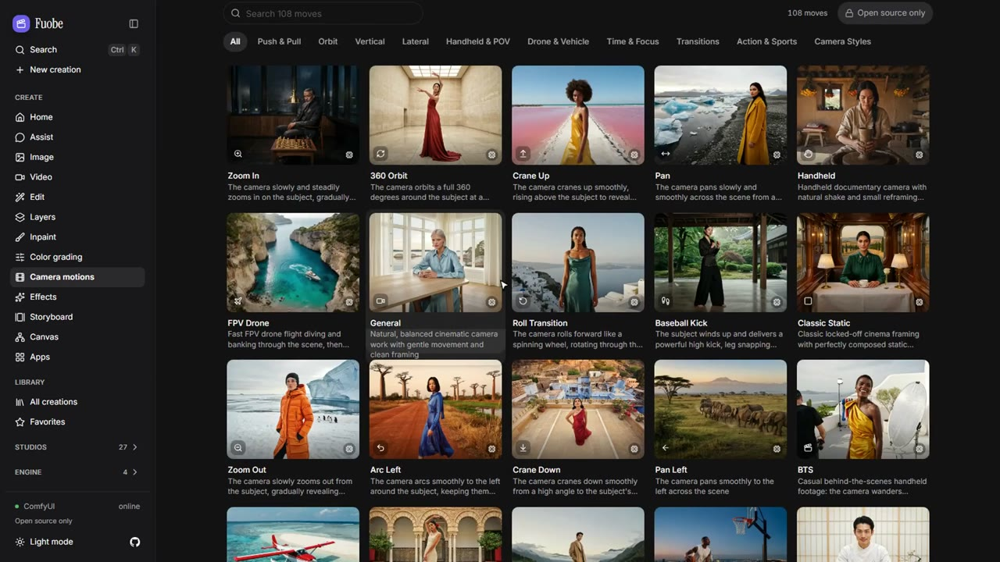
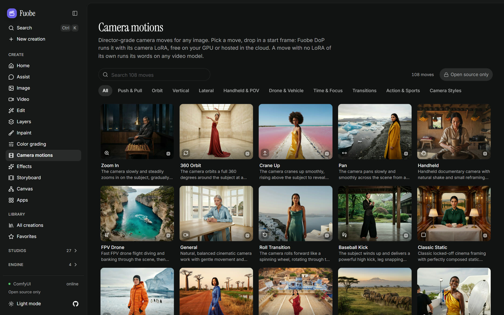
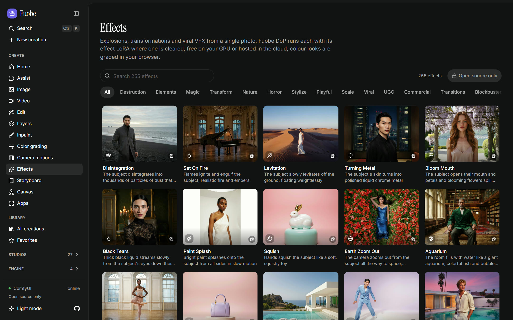
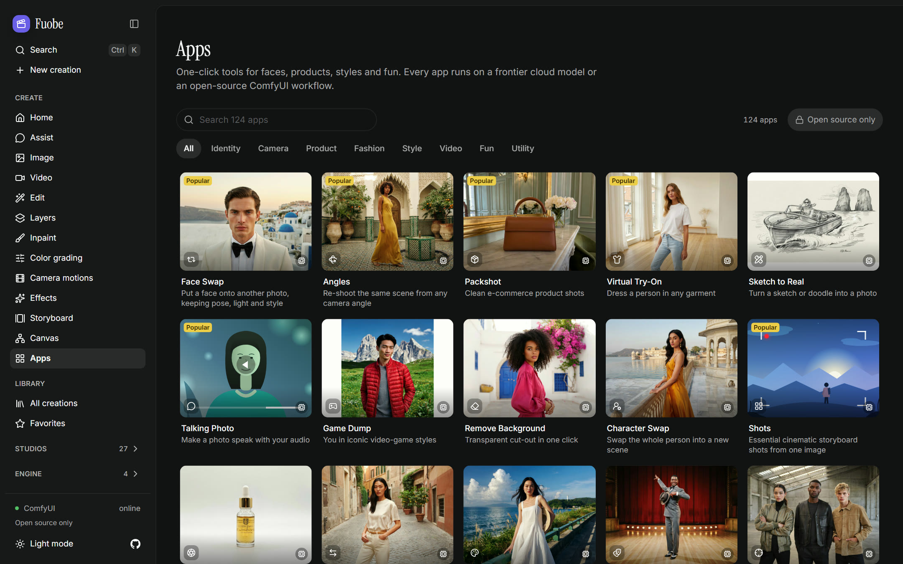
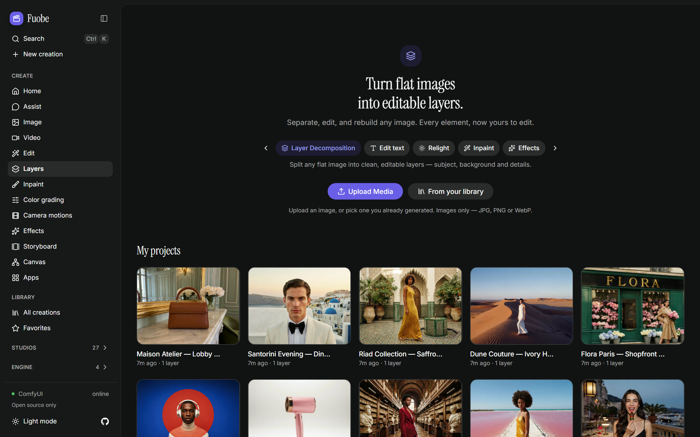
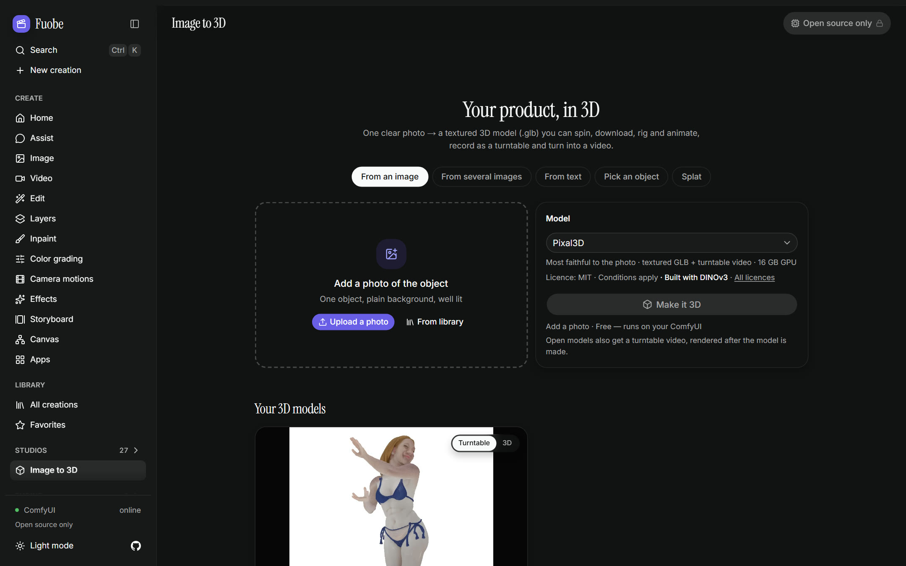
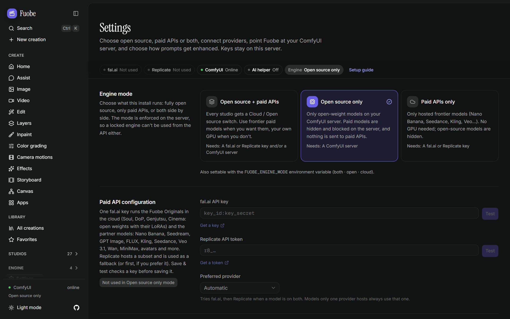

# Fuobe features

[← README](../README.md) · [Setup and self-hosting](SELF-HOSTING.md) · [Development](DEVELOPMENT.md) · [Status](STATUS.md)

Fuobe is a complete creative studio you can run yourself: 108 camera motions, 255 effects and 125 apps, Cinema, Shorts, Marketing and Ads studios, Layers, Canvas, Storyboard, Image to 3D, voice and music tools, and an Assist agent that plans and runs whole jobs. Every tool runs either on open-weight models on your own GPU through **ComfyUI**, or on frontier models with your own fal.ai / Replicate key. Flip one switch. Licences are information, not gates: **Settings → Models & licences** shows the licence of every model, LoRA and node pack.

**Every preview on the site was rendered locally on ComfyUI** with open weights: stills with Ideogram 4, before/after end frames with Qwen Image 2.1 edits, and the motion clips with MiniMax H3 (including its Orbit LoRA for bullet time), all on one RTX 5090.

▶ **[Watch the product demo](media/fuobe-demo.mp4)** (80 s, 60 fps): the studio itself, then how every preview was rendered on ComfyUI

| Camera motions | Effects | Apps |
|---|---|---|
|  |  |  |
| **Layers** | **Image to 3D** | **Settings** |
|  |  |  |

> Project status, what works, what's verified and what's left: **[docs/STATUS.md](STATUS.md)** (also in-app at `/status`).

## Contents

- [Assist, skills, MCP and the command line](#assist-skills-mcp-and-the-command-line)
- [Fuobe Originals](#fuobe-originals)
- [Create](#create)
- [Studios](#studios)
- [Library and sharing](#library-and-sharing)
- [Getting around, models and licences](#getting-around-models-and-licences)
- [Elements, Soul ID and LoRAs](#elements-soul-id-and-loras)
- [Catalog and the open-source engine](#catalog-and-the-open-source-engine)
- [Evaluation harness](#evaluation-harness)
- [Demo mode](#demo-mode)
- [Model licences](#model-licences)

## Assist, skills, MCP and the command line

- **Assist:** describe the whole job in a chat; the agent picks models, shows the plan and its cost, runs it when you approve, checks the results and chains the next step. Free / Smart / Manual modes, 20 built-in **skills** (SKILL.md playbooks, or upload your own), **projects** with instructions and up to 20 sources (links, files and PDFs, elements, notes), and **memory**. **Scheduled tasks** run a request daily, weekly, every 1–168 hours or once, in your time zone; each run is a new chat that asks before it generates, or runs on its own within a cost cap ($2 a run by default). Your own **MCP connectors** (remote MCP servers, added in Settings → Assist · connectors) give Claude chats another app's tools: Anthropic's servers call them, so a local one needs a public tunnel, and their tools run without asking Fuobe, so each connector's Allowed tools list is the safeguard. Runs on Claude, a local model (Ollama, LM Studio, Unsloth Studio or another OpenAI-compatible server), or an offline planner (connectors need Claude)
- **Skills that run by themselves:** **Make a skill from this…** (the ⋯ menu on a result) or **Make a skill** (the Library's selection bar) turns the steps behind your results, Edit and Animate chains made by hand included, into a skill of your own: pick the inputs that change next time, check it for free, save it. In **Assist → Skills**, a skill with a recipe (`recipe.json`: its steps and inputs) says "Runs by itself" and gets a **Run…** form: typed inputs, the price before it starts, the steps, and a Many tab for up to 50 CSV rows. No chat or AI is involved. A skill must pass a free check on an engine before it runs there, and asks for a new check when a model it uses is retired, switched off or repriced. ⌘K has "Run a skill", and a skill downloads as a .zip with its files. Translate & dub, Katana and Captions results can become skills; results from other studios are refused for now, naming the studio
- **MCP:** other agents (Claude Code, Claude Desktop, any MCP client) can drive the studio through `/api/mcp`, including whole studio jobs that open in their studio (a Layers project, a Shorts session, a dub to review, a Faceless episode, an Ads Studio batch, the Captions editor, a Katana edit; Genjutsu, the Character Swap Studio, Remove object, Content Factory, the AI Influencer builder, Evolution and Layers' Inpaint, Enhancer and Save as element aren't tools yet) and the skills as prompts. `npx skills add workingprototype/Fuobe` installs the skills in other agents
- **Command line:** `fuobe` lists models, prices a run, generates, waits and downloads from a terminal, a script or a coding agent; see [`docs/cli.md`](cli.md). `--engine` also picks an Original's engine, and `--look` a Fuobe Soul look (`fuobe generate --help` lists it; cli.md doesn't yet)

## Fuobe Originals

**Fuobe Originals:** each is one model that runs on both engines, built on open-weight models and public LoRAs: free on your GPU through ComfyUI, or paid on fal or Replicate, with no Higgsfield call

- **Fuobe Soul**, **Fuobe Soul HD** and **Fuobe Soul Cinema** (Image studio) — a Look picker with 139 looks in two sets named after Higgsfield's versions (Soul 2.0: 33, Soul: 106), with categories, search, drawn covers and a Strength slider. Attach a picture and Fuobe Soul restyles it with the look. Soul HD (Qwen-Image 2512) is for lettering; Soul Cinema has one film look and 21:9. Your browser finishes each result (crop, grade, overlays such as DigitalCam's date stamp) and keeps the raw picture. 87 looks use civitai LoRAs: without a civitai key, a run leaves those out and says so. The PixeletedFace look pixelates faces in a second "Face mosaic" step (SAM 3.1; free on your GPU, $0.01 a picture in the cloud), and the picture before it stays in the Library as a step. The Storyboard's Look chip puts any of the 139 looks on a board
- **Fuobe DoP** (Wan 2.2) and **Fuobe DoP · LTX** (LTX-2.3) — the camera motions and effects as recipes: a move's LoRAs, a camera LoRA or (on your GPU) a Fun Camera pose, a colour grade or a relight where it has one, else its words. On the open engine, picking a move in the Video studio switches to the model it runs on (a few run on LTX-2.5). In the cloud, 184 of the 363 motions and effects use DoP's routes and switch the same way; the other 179 only add their words to the model you picked (their own route is Kling 2.5 Turbo). 15 colour-grade effects hand the clip to Color grading with the grade picked, 6 relight effects relight the start frame first, the 32 Mixed Media effects first draw the start frame in their look on Fuobe Mixed Media (on both engines; in the cloud they ran on Kling 2.5 Turbo before PR #14), and Mix stacks both presets' LoRAs on either engine
- **Fuobe Cinema** (Cinema Studio's video default) — Wan 2.2 14B Lightning free on your GPU (3 or 5 s, no sound), or LTX-2.3 on fal with sound and its built-in camera LoRAs (4–30 s: one call makes up to 20 s, and a longer take gets an automatic extend). In the cloud, 14 of Cinema's 33 camera moves use LTX-2.3's camera LoRA, start frame or not; with a start frame, a move with a Wan 2.2 LoRA switches the take to Fuobe DoP, and Rack Focus uses LTX-2.5 Fast's focus move. On your GPU, with a start frame, a move takes its Wan 2.2 LoRA or a Fun Camera pose. Otherwise the move goes into the prompt
- **Fuobe Genjutsu** (Motion, Swap and Restyle; Motion and Swap also come in a cheaper, faster Standard quality) and **Fuobe Character swap** — Genjutsu's defaults: Wan Animate for motion transfer, SAM 3.1 and Wan VACE for object swap, Wan 2.2 Fun VACE for restyle, and MiniMax H3 with Akatz Labs' Character Swap LoRA for Character swap
- **Fuobe Soul ID** — train a character or a look as a LoRA, free on your GPU through AI-Toolkit or on fal's trainers (see Elements below)
- **Fuobe Marketing Image** (Marketing Studio and Ads Studio) and **Fuobe Try-On** (Fashion Factory) — Marketing Image is Qwen-Image-Edit 2511 with your product photo (Qwen-Image 2512 without one), and your browser sets the headline, CTA and logo over the picture in the brand fonts. Try-On is FLUX.2 [klein] 4B with a try-on LoRA ($0.03 a picture in the cloud)
- **Fuobe Mixed Media** and **Fuobe Shorts** — Mixed Media redraws every frame with Z-Image Turbo along its outlines, with the look's LoRA and one seed (up to 240 frames; about $0.01 a frame at 1K in the cloud, 16 GB on your GPU). Its Smooth mode draws the first frame in the look and lets Wan 2.2 Fun VACE carry it through by depth. Shorts restyles each segment's first frame with Qwen-Image-Edit 2511, then Wan 2.2 Fun VACE carries it through and the segments are joined under the clip's sound (about $0.19 a second for a 30 fps clip at 720p in the cloud, plus the first frames; 24 GB on your GPU)
- **Fuobe Evolution** (Video tools → Evolution) — changes a 4–30 s clip by Low, Medium or High toward a creative direction and up to 40 reference images, priced first, with a before/after wipe and the clip's own sound. On your GPU, Wan 2.2 Fun VACE starts from the clip (24 GB); in the cloud it runs fal's LTX-2.3 video-to-video, a different model that doesn't see the references. "Write it for me" writes the direction with Claude, an Ollama vision model or an offline writer
- **Fuobe Angles** (a beta app beside Angles) — the same shot from another camera (rotate, height, distance, lens) on Qwen-Image-Edit 2509 with a Multiple-angles LoRA: $0.035 in the cloud, free on your GPU (24 GB). The Angles app keeps its recipe. **Fuobe Speak** (InfiniteTalk) and **Fuobe Speak · Motion** (Wan 2.2 speech to video) are in Lipsync's model menu on both engines; Lipsync's defaults don't change
- Built and checked in demo mode, by unit tests and, for their GPU graphs, by a CPU ComfyUI that accepts them without running weights; no look, move, take, swap, frame, clip or training has run on a GPU or with a paid key yet, so their quality and real bills are unmeasured, and the three MiniMax H3 graphs have never loaded in a ComfyUI

## Create

- **Create:** Image · Video (text, image, start/end frame, **Frames**: up to 10 stills on a timeline, reference images and clips, multi-shot, draft mode) · Edit · **Layers** (split a flat image into editable layers, edit text with the lines found for you on either engine, Inpaint a painted area, an Enhancer (skin, soft glow, sharpen, detail), regional edits, save a layer as an element, cropped or positioned zips) · Inpaint & Draw to Edit · Color grading · Camera motions and Effects (on Fuobe DoP) · Storyboard (Popcorn: a board in one of Fuobe Soul's looks if you like, priced next to Generate, and turned into a film; cloud boards start on hosted open models, Z-Image Turbo or Qwen-Image-Edit, then Qwen-Image-Edit 2509 with a next-scene LoRA, and "Frames made on" switches them to Nano Banana Pro) · **Canvas** (wire prompts, files and models into node workflows; every template in a cloud and an open-source version, 10 Effects 2.0 chains among them (your photo, a "Set the scene" edit, then a 5 s Fuobe DoP clip); up to 20 pages per board, groups you can run as one, comment pins with replies, and drawing, shapes and text from a toolbar with keys; a Table node runs the node it feeds once per row; Change voice, Clone voice, Translate (text, or a dub of a video) and Video concatenator (cut, mute and join up to 50 clips) nodes) · Apps
- **MOSS-Image** (Image studio → model menu → MOSS-Image) — OpenMOSS's picture model, made for Chinese and English text in pictures. In the cloud it runs on fal at $0.05 per megapixel, up to 4 images (fal's safety checker returns a black image when it flags an output). On your GPU it is free, on ComfyUI's built-in nodes, with about 15 GB of files and 16 GB of VRAM (a guess); **Options → Quality** picks Standard (25 steps), Best (50), Fast (8 steps, an extra 5.4 GB file) or Base model (MOSS-Image Base, 50 steps, an extra 5.4 GB file). Its text encoder is the int8 Qwen3.5-9B: the w4a8 build in ComfyUI's template crashed the graphics driver on a test PC. The Image studio's controls chip now reads **Options** (it read "Director"). Text placed in boxes comes later: the code that turns layout boxes into MOSS's prompt is in (`src/lib/layout-prompt.ts`), but the screen to draw them, Layout mode, is the next package in the queue
- **The newest open image models, first on your GPU** — Ideogram 4, Qwen-Image 2.1 and its Turbo, Krea 2 (Realism, Turbo, Edit, Identity Edit, Image to image, Inpaint) and FIBO 2 (Dev, Edit Turbo), from the owner's ComfyUI workflows. On the open engine the Image studio opens on Ideogram 4 (on Qwen-Image 2.1 for an account, a guest, or an install with no local LLM to write Ideogram's caption) and Edit and Inpaint on Qwen-Image 2.1; every model menu's "Best" list puts the new models first (text to image: Ideogram 4, Qwen-Image 2.1, Krea 2 Realism, MOSS-Image, then FIBO 2 Dev; edits: Qwen-Image 2.1, its Turbo, FIBO 2 Dev and Edit Turbo, then Krea 2 Edit), and so do apps, Layers, Canvas, Cinema stills, Photodump, Fashion Factory and Character swap's anchor. Apps and tools that run a LoRA trained on an older model keep it (Angles, Relight, Product shot, Try-On, Cinema's recompose). Ideogram 4 reads a JSON caption, which Fuobe writes from your words (with your local LLM, never a paid API; a plain caption without one) and keeps as the run's prompt. When Ideogram's safety filter sends its grey card instead of a picture, the run fails and says what to try. Soul Location doesn't offer Ideogram 4 (pictures of empty places hit that filter most), and a new Layers layer starts on Qwen-Image 2.1. Qwen-Image 2.1, FIBO 2 and Krea 2 Edit take up to 4 references (Krea 2 Edit 2) and leave out the ones you don't give; an edit keeps image 1's shape and size, so Edit and Inpaint show no aspect or size choice for them, and Qwen-Image 2.1's inpaint and expand take the picture alone. An app run made before an app moved to Qwen-Image 2.1 (a retry, Run again, Reuse) runs on Qwen-Image 2.1 and says so. About 92 GB of new files, 20–24 GB of VRAM (estimates), ComfyUI 0.42.0; Krea 2 runs Comfy-Org's fp8 Krea 2 Turbo, the file the owner's edit workflow loads. Krea 2 Inpaint also needs the ComfyUI-Krea2-Ostris-Edit node pack, so it isn't in Inpaint's "Best" list. Qwen-Image 2.1, Ideogram 4 and FIBO 2 weights are non-commercial. None of the 16 graphs has rendered through Fuobe yet

## Studios

- **Cinema Studio** — projects and scenes, Director's Panel (camera, lens, 50 palettes, lighting rig, Emotion Wheel), 33 camera moves (# in the prompt bar), AI Director, image grids, Soul Cast and Soul Location, and **3D scenes**: turn a still into a scene you fly through, set the lens and frame, and Capture a re-rendered take from that view. Takes run on Fuobe Cinema by default on both engines (Seedance 2.5, Kling 3.0 and Veo 3.1 stay in the cloud menu, LTX-2.5 and Wan 2.2 14B on your GPU), stills on Fuobe Soul Cinema, Soul Cast on Fuobe Soul in the cloud (the Soul Cast sheet on your GPU) and Soul Location on Fuobe Soul. A project can be shared as a read-only link
- **Fly path** (Cinema → a project → a 3D scene take) — film the still along a camera path. The still's own view is keyframe 1: fly the camera and press **+ Keyframe** (or K), up to 12 keyframes in all, or pick one of ten moves (orbits and arcs, a tilted ring, a figure-8, dollies and trucks). **Preview** the flight, then **Film this path**: it lands as a new "Fly path" take. In the cloud, MiniMax H3 Max camera controls film 3–15 s at 480P to 1080P (5 s at 768P costs $0.40, or $0.26 at fal's launch price through 2026-10-31; 15 s at 1080P costs $2.40). On your GPU, Wan 2.1 + Uni3C films about 5 s (81 frames at 16 fps) at 480p for free, guided by your browser's render of the scene along the path (about 48 GB of VRAM, the library's highest)
- **Shorts Studio** — restyle up to 2 minutes of your own footage with 44 looks (or your own references), in segments you can regenerate, stitched back under your sound, on Fuobe Shorts by default on both engines (Gemini Omni Flash and the other partner models stay cloud choices); **Mixed Media** — 33 looks for 1–10 s clips with per-preset settings and a preview frame, 14 of them with a LoRA; the clip's frames are sampled at the rate you pick (4–24 FPS) and **Per frame** redraws each one on Fuobe Mixed Media by default on both engines (Nano Banana 2 and Seedream 5.0 Flash stay cloud choices, priced per frame), **Smooth** draws the first frame and carries it through on both engines, and **Fast** restyles in one video-to-video pass in the cloud. In the cloud, Smooth and Fuobe Shorts refuse a selection under 17 frames or a clip under 5 fps at the estimate, before anything is paid for
- **Genjutsu** — keep a 4–30 s clip's motion, camera and framing and change what is in it: motion transfer, **Character swap**, object swap, restyle (44 looks, Fuobe Soul's 139 or your own images) or insert, with reference images, priced before it runs. Every mode but Insert defaults to a Fuobe Original on both engines, and the picker shows each model's source (Original, open weights or partner) and licence. Character swap turns the person in a 5–15 s part of one shot (up to 30 s, in pieces or windows) into your character from one image, keeping the performance and the sound: pick who (largest, leftmost, rightmost, a number or, on your GPU, a click), 480p or 768p, and by default your character goes into the first frame first; "Describe my character" and "Use the clip's words" help write the prompt. For whole clips, **Open in Character Swap Studio** takes the clip and the character there
- **Character Swap Studio** (`/character-swap`) — Akatz Labs' H3 Character Swap workbench, rebuilt in Fuobe on MiniMax H3: put your character into whole clips, shot by shot, and get each clip back with its own timing and sound. A project holds one character (a picture and a description) and up to 20 clips (.mp4, .mov, .mkv, .webm or .avi, each up to 149.66 s and 200 MB), worked through seven stages: **Shots** (Detect edits finds the cuts in your browser; mark each shot Replace character or Keep original), **Words** (transcribe, say who speaks each line, build the shot prompts), **Who to swap** (largest, leftmost, rightmost, person #n or words, plus clicks on any frame, giving mask versions you approve), **Scene anchors** (make or import a still of the scene with your character in it), **Segments** (5, 10 or 15 s, each starting fresh or continuing the one before; a continuation starts itself when that take is done, even with the page closed), **Takes & review** (several takes, Compare, Keep / Maybe / Skip with notes, Export decisions) and **Assemble** (the chosen takes over the original timeline with the clip's sound, to download and in the Library). Prices show before anything runs (only a cloud browser copy of a clip your browser can't play, and anchors on GPT Image 2.5 Sunburst, which bill by tokens, are left out of the estimate), and demo mode runs the whole flow for free. On your GPU, H3 Relay 2.0 swaps only the person in your approved mask, matches the anchor and continues from the take before (free; a 24 GB GPU and the opt-in H3 Relay pack). In the cloud, fal's MiniMax H3 with Akatz Labs' swap LoRA ($0.075/s at 768p, $0.0625/s at 480p) has no mask: the whole frame is regenerated and who to swap goes into the prompt. Built and checked in demo mode only: nothing has run on a GPU or with a fal key, its two GPU graphs have never loaded in a ComfyUI, and the Finish stage (a clean background plate and cut-outs) shows as not available
- **Marketing Studio** (84 templates; every picture format starts on Fuobe Marketing Image on both engines, with the words set over the picture in your browser, and Bria, Nano Banana Pro, GPT Image 2.5, Ideogram and Recraft stay cloud choices), **Click to Ad** (with a logo end card), **Ads Studio** (brand kit from your website, up to 20 ads per product in 1:1 / 4:5 / 9:16, each one written copy and one picture laid out in your browser with your logo, colours and fonts; the picture is Fuobe Marketing Image's by default, and in the cloud "Pictures by" picks Nano Banana Pro or GPT Image 2.5 instead) and **Ad Multiplier** (whole-ad edits in the cloud on Kling O3 or Happy Horse video edit, which keep the sound and recreate up to 15 s, or Gemini Omni Flash)
- **Moodboards** (the curated looks open on Fuobe Soul; **Train as a look…** trains a board into a look of its own for Fuobe Soul, on either engine), **Color signature** (Soul HEX palettes; with a Fuobe Soul model on the open engine, the colours are locked after generating by default), **Photodump / Instadump** and **Fashion Factory** (a character with a Soul ID runs on Fuobe Soul; without one, Photodump uses Qwen-Image-Edit 2511 in the cloud, with Nano Banana Pro and Seedream 5.0 Pro as choices, and Qwen-Image 2.1 on your GPU, with Qwen-Image-Edit 2511 as a choice; Fashion Factory dresses the shot on Fuobe Try-On and makes the photoset on Qwen-Image-Edit 2511 in the cloud (FASHN and Nano Banana Pro are choices) and on Qwen-Image 2.1 on your GPU (Qwen-Image-Edit 2511 a choice)), **Character Sheet** (Build from scratch and From a description draw in Fuobe Soul's Realistic look: Fuobe Soul in the cloud, the Soul Cast sheet on your GPU)
- **Turnaround video** — one button films a character all the way round, and the sides it has no picture of are drawn first. It is **Turnaround video** on a finished Character Sheet (`/character-sheet`) and in Cinema's Soul Cast results (the film lands as a take in the project), and **Fly around** on a character's page. One dialog holds five picture slots, "Draw the missing sides", the route, length, shape, price and consent. On your GPU, Wan 2.2 14B films each quarter turn and joins them, and Qwen-Image-Edit 2511 with the Multiple-Angles LoRA draws missing sides: free, about 24 GB of VRAM, and no new files (it uses Frames mode's and the Angles app's). In the cloud: **References** (MiniMax H3 Max, the default with 2 or more views or a sheet; $0.40 for 5 s at 768P), **Keyframes** (FLUX 3 Max; $0.0425/s through 2026-11-07, then $0.17/s) or **Camera path** (H3 Max camera controls, the default with a front view only). Each drawn side costs about $0.035 (Qwen Multiple Angles), and with only a sheet the front is first drawn with Nano Banana Pro ($0.15). For a real person you tick Soul ID's consent line: a character's page always asks (or shows it as given at Soul ID training), the Character Sheet starts "A real person" on for sheets from uploaded photos, and Soul Cast's made-up actors skip it
- **AI Influencer** builder — build a character game-style: a character type (Average, Bold or Extreme human, or a creature: insect, frog, cat, dog, rodent or bird) and traits in 18 categories, with Shuffle, then save the sheet as a character. The sheet is drawn in Fuobe Soul's Realistic look (in the cloud on Fuobe Soul, with hosted Qwen-Image-Edit 2511 adding your face or clothes; Nano Banana Pro and Seedream 5.0 Pro stay choices)
- **Faceless Studio** and **Explainer** — channels, scripts, narrated and subtitled episodes with a timeline editor; "Frame by frame" moves the camera slowly over each still (a Ken Burns move), the music loops to cover long films, and Explainer reads PDF and Word sources
- **Content Factory** — a faceless series in the style of a clip you like: upload it, paste a TikTok, Instagram or web-page link, or pick one of 8 preset styles. Fuobe reads it into a style brief you can edit, prices the whole series, then makes 1–10 Faceless episodes of 30 s to 5 min here, or gives you a prompt for Claude Code to make them through Fuobe's MCP server
- **Translate & dub** (your voice, lip-synced, over the original music and effects on both engines), **Captions** (transcribe, edit, burn in), **Trim**, **Katana** (recreate a reference edit with your subject; Fuobe Genjutsu · Motion is one of its motion models, the default on your GPU), **Image to 3D** (from one photo, several photos of one object, words or an object picked in a photo, or one photo as a Gaussian splat to open in a splat viewer such as SuperSplat; Rig & animate a finished model; Pick an object and Rig & animate run on the cloud only; on your GPU one photo goes to Pixal3D by default, and the server finishes each model for the web and renders its turntable on the CPU), Lipsync & avatars (priced on the voice's length; Fuobe Speak follows the voice for up to about 29 s a call in the cloud, where a longer one is cut with a note, and up to 40 s on your GPU, where a longer one is refused), Motion control, Edit / Extend / Reframe video (edits that keep the clip's length are priced on its seconds, and a clip outside a model's window is refused with the reason), Video tools (**Remove object**: type it, paint it or, on the cloud, click it, and it's erased from the clip; on your GPU, **H3 Person Removal** erases a person you name, with the opt-in H3 Relay pack; **Evolution** (above); matte, relight, depth (on your GPU, Video Depth Anything large is a non-commercial choice beside the default small model), join clips, match colors), Upscale (images and video, **FPS Boost** and slow motion, **SDR to HDR** (with LoRAs in the cloud), and **Export** to ProRes, H.265 10-bit, FFV1 or EXR frames on the open engine), Audio (speech with voice picker and cloning, dialogue, voice change, sound effects, music, sound for video, transcribe, **split soundtrack**, **loop / extend** and **join**), and a Virality predictor (a labelled heuristic)
- **Split soundtrack** (Audio → Split soundtrack, `/audio/split`, or **Split soundtrack** on an audio or video result) — split a song, podcast, film clip or video into dialogue, music and effects, then remix it. **Best** (DBS-TIGER) is preselected on a CUDA GPU and **Fast** (DBS-BSRNN) anywhere else, with optional stereo stems; on a 4-CPU host, Fast took about 4 minutes per minute of audio and Best about 3 times as long. The mixer has Dialogue, Music, Effects and Music & effects, each with solo, mute, a −24 to +6 dB level and a FLAC download, plus five presets (Original, No dialogue, Dialogue only, Music only, Music under dialogue). **Your splits** reopens earlier splits, **Export mix** saves a 16-bit WAV to the Library, and **Put back on the video** puts the mix on the clip (free on your GPU, or $0.0002/s with fal's merge-audio-video). It runs only on the open engine, on your ComfyUI (GPU or CPU) with the ComfyUI-DBS node pack: DBS isn't hosted on fal or Replicate, and the owner chose no stand-in model, so the cloud engine says so and offers "Use open source". A file with no sound, or a model your ComfyUI lacks, is refused before anything runs, with install help. A source with more than 2 channels gives mono stems, so a 5.1 video gets a mono mix back, and a very long split downloads only as stems. A clip that already has sound (Sound for video, a mux, Lipsync, Trim, Captions) offers Split soundtrack as its next step instead of Add sound
- Round 5, part 2's tools (MOSS-Image, the fly path, the turnaround and Split soundtrack) were built and checked in demo mode, by unit tests and by a CPU ComfyUI that accepts their graphs; Split soundtrack also made real splits with both DBS models on a CPU ComfyUI with ComfyUI-DBS. None has run on a GPU or with a paid key, so their quality and real bills are unmeasured. With public sign-up on ([`public-signup.md`](public-signup.md)), guests and accounts can see what a split or a turnaround would cost, but only the owner runs them, the fly path included (guests and accounts can't make Cinema projects); accounts can run the open MOSS-Image on their own ComfyUI, the only one of these they can run, can't use Export mix (it saves into the owner's Library), and the owner's characters stay hidden from them ("Character not found")

## Library and sharing

- **Library:** all your results (images, videos, audio, text, 3D) with layouts, filters, nested folders, pins, a review status (In progress, Needs review, Approved, Rejected), Select all, bulk zip download and a Trash with 30-day restore. Helper steps stay hidden until you ask (Show steps), and an upload is deleted only when nothing uses it. Results arrive live, and a browser notification can tell you when a job finishes while Fuobe is in the background. **Share link…** on a result, a folder (with its subfolders) or a Cinema project makes a read-only page: choose a title, whether prompts show, and how long the link works (always, 1, 7 or 30 days). **Publish** turns selected results into a portfolio page (Feature, Series or Carousel, with a cover). The **Shared** tab lists your links with their views, to make a new link, hide prompts, re-date or revoke. A link opens without signing in, for anyone who can reach your Fuobe (Fuobe doesn't host these pages), and shared files have their embedded generation data blanked (ComfyUI workflows, video tags, EXIF). Canvas boards can't be shared yet

## Getting around, models and licences

- **Home:** the composer with four prompts to try (one opens Assist with a job typed in), then a wall of eight real covers that play as they come into view, rows of effects, camera motions and apps (a before/after to drag), every studio and tool, what Assist does and plans with, the open-source numbers and the newest open models, all read from the catalog, and three ways to start. **Pause previews** stops every preview that plays by itself, on every page, and is remembered
- **Getting around:** a **Get started** card on Home and Settings (use paid models, use your GPU, or just try the demo); a **⌘K / Ctrl+K palette** that searches pages, settings, apps, motions, effects, models and recent creations, and runs your skills; Start on Home runs the job and says first what it costs; **Settings → About & licences** lists every open model's licence, and its **Credits** list the attributions behind Split soundtrack's DBS models (their DnR v2 training data and the code they vendor)
- **Connect your GPU** (`/connect`): checks that your ComfyUI has every node pack and file a tool needs, and shows each tool as Ready, One step away, Needs setup or Needs a bigger GPU. Split soundtrack, Fly path and Turnaround have rows of their own, and MOSS-Image is listed under Image
- **Models & licences:** **Settings → Models & licences** (`/settings/models`, also from ⌘K, About & licences and the Models page) shows the licence of every model, LoRA and ComfyUI node pack, with switches per licence class, provider, node pack, LoRA and model. Everything is on by default, and LoRAs licensed for your GPU only go to fal or Replicate with a note unless you turn on **Keep them on your GPU**. A model you switch off leaves every picker and listing (studios, Canvas, Cinema, ⌘K, the API and CLI, Assist and Fuobe's MCP server); automatic picks move to the next model that is on, and a run that can't is refused, naming the switch. Switching off an adapter LoRA an Original's recipe always loads (the try-on LoRA, say) takes that Original out the same way. Each model round 5, part 2 adds has its own switch, and ComfyUI-DBS (MIT) one as a node pack. About 15 hosted open-weight models show a "Weights:" line with their weights' licence, and a long licence note opens with More. Anyone who can sign in can change it, and trainings and Assist's own Claude or local-model calls aren't under the switches

## Elements, Soul ID and LoRAs

- **Elements:** save characters, locations, props, styles and voices once, then `@mention` them in any prompt; save one straight from a Layers layer or an AI Influencer sheet. **Train** a character (with a consent tick) or a style as a **Fuobe Soul ID** from 5 to 80 photos (20 or more recommended): free on your GPU through AI-Toolkit, or on fal's trainers (about $1.50 to $6.40, priced first). It trains for one base: Z-Image Turbo (Fuobe Soul and Soul Cinema), Qwen-Image 2512 (Fuobe Soul HD), FLUX.1 [dev] and Krea [dev], FLUX.2 [dev], FLUX.2 [klein] 4B, and, on fal only, FLUX.2 [klein] 9B and Krea 2 (the klein and Krea 2 LoRAs run in the cloud only); the dialog shows each option's engine, price, time and licence. The LoRA then works on every model of that base, on both engines where the base has both, whenever you @mention the element. With no fal key and no AI-Toolkit (and Demo mode on "auto", the default), a training is an 8-second demo that trains nothing, and the dialog says so. An old Soul ID from Higgsfield offers "Retrain for Fuobe Soul" (Higgsfield's Soul IDs can't be exported)
- **LoRAs:** small add-on files that give an open model a look, a camera move or an effect. **Settings → LoRAs** lists a library of 118 researched LoRAs (67 looks, 23 motions, 24 effects and 4 adapters that an Original's recipe always loads: try-on, next-scene, Multiple-angles and FusioniX) with each one's licence and source, and downloads them. On the open engine, a LoRA ComfyUI doesn't have is downloaded into your LoRA folder before the run and checked against its SHA-256 fingerprint. On the cloud, twelve hosted models take LoRAs: Z-Image Turbo (hosted, on fal and Replicate), Qwen-Image 2512, Qwen-Image-Edit 2511, FLUX.2 [klein] 4B, Wan 2.2 A14B image and video, LTX-2.3 22B, and, for Soul ID LoRAs, FLUX.1 [dev], FLUX.1 Krea [dev], FLUX.2 [dev], FLUX.2 [klein] 9B and Krea 2 Turbo. Since PR #14, Upscale's SDR to HDR (LTX-2.3's HDR pass) takes up to 3 as well. The Fuobe Originals' cloud routes send their looks' and moves' LoRAs too (Character swap sends Akatz Labs' swap LoRA, Fuobe Try-On its try-on LoRA, Fuobe Mixed Media its looks' LoRAs), and a LoRA a run can't carry is left out with a warning. Fuobe Soul's looks take their LoRAs from the library, and a motion's or effect's LoRA that is in the library uses its pinned download and licence

## Catalog and the open-source engine

- **Catalog:** 198 cloud models + 104 open-source models + 20 Fuobe Originals that run on both (plus 54 hidden ones: chain steps and studio helpers such as the fly path's two routes, self-tests, browser tools, and Gemma 4 speech translate, which no studio uses yet), 125 apps, 108 camera motions (mix any two), 255 effects; 480 of their cards show a cover rendered on a GPU (48 of them short clips), the rest a drawn preview. A launch price (FLUX 3 Max's, through 2026-11-07) is read on the day: a run is priced on the day it is planned, and a page shows that day's price once it has loaded, never one read while the page was built
- **Open-source engine:** 174 API-format ComfyUI workflows (official templates, community packs and hand-built graphs), 152 of them validated against real ComfyUI node definitions (the 16 graphs of the newest image models, and MOSS-Image's since its encoder became the int8 file, were checked only against a ComfyUI's node list, and wait for a check on one that isn't busy; the three MiniMax H3 graphs and the Character Swap Studio's two H3 Relay graphs need node packs the validation server doesn't have; Split soundtrack's DBS graph was checked, and ran, on a separate CPU ComfyUI with ComfyUI-DBS), plus 84 researched LoRAs (camera moves, VFX) that 122 motion, effect and app presets use today (43 of them are also in the Settings → LoRAs library, and 36 come from civitai)

## Evaluation harness

- **Evaluation harness (for developers):** `pnpm eval:run` (or `fuobe eval`) runs a suite of cases for each Fuobe Original, built or planned (Fuobe's own open-weight versions of Higgsfield's in-house models, such as Soul and DoP) on the demo, open or cloud engine, scores the results with pinned open models, runs a blind A/B review and says whether a recipe may become a default. Fuobe Soul, DoP, Cinema, Genjutsu and Soul ID are in the app, and since PR #14 Marketing Image, Try-On, Mixed Media, Shorts, Evolution, Angles and Speak too; their suites run the shipped models (with `soul-cinema`, `soul-hex` and `dop-mix` suites and a palette metric; since PR #12 the `cinema` suite has Director scenes and LTX-2.3 camera moves, `genjutsu` has Character swap and the Lite tiers, and `soul-id` trains per base and as a look, and needs your own photos of a person who agreed; PR #14 adds `marketing`, `evolution`, `popcorn` and `angles`, and `mixed-media` and `shorts` now compare the Originals with partner models; PR #15 adds `turnaround`, 4 cases for the turnaround video on each of its routes). Real runs of most suites need your own inputs in `scripts/eval/local/` (`popcorn` needs none). Cloud runs are priced first and capped (default $5), and Higgsfield is never called. A recipe's licences are a note on its verdict, not a hold (`eval:promote --licence-hold` restores the hold, and `--commercial-only` keeps non-commercial metric models and covers out). Nothing has been measured on a GPU or the cloud yet; see [`scripts/eval/README.md`](../scripts/eval/README.md)

More on running it: [Development → Evaluation harness](DEVELOPMENT.md#evaluation-harness).

## Demo mode

- **No keys? No GPU?** Demo mode lets you click through everything with clearly-labelled placeholder outputs.

## Model licences

Fuobe's code is open source. Model weights, LoRAs and ComfyUI node packs have their own licenses, and Fuobe treats them as information, not gates: **Settings → Models & licences** shows each one's licence and class (commercial use allowed, commercial use with conditions, restricted regions, non-commercial, research only, proprietary paid API, licence unknown), each with a switch. Everything starts switched on, so check what your use allows and switch off what doesn't fit. Several open models used here are **non-commercial** (FLUX.1/FLUX.2 [dev] and FLUX.2 [klein] 9B, which Soul ID can also train on, inswapper, MMAudio weights, USO's FLUX.1 base, some LoRAs, ComfyUI-Whisper's node code, now installed by default, TRIBE v2, and Video Depth Anything large, a Depth map choice on your GPU that isn't the default), HunyuanVideo-Foley and Hunyuan3D 2.1 exclude the EU, UK and South Korea, MiniMax H3 (Character swap's default, H3 Person Removal and the Character Swap Studio) excludes the US, the EU, the UK and South Korea, needs MiniMax's written authorization above US$20M yearly revenue and asks commercial products to show "MiniMax H3", Stable Audio 3 is free under US$1M revenue (Stability Community licence), and VOID (Remove object's "Shadows and reflections too" on the open engine) is built on CogVideoX-5B, whose licence asks you to register before commercial use. Fuobe DoP · LTX on your GPU uses LTX-2.3 under the LTX-2 Community License (free below US$10M annual revenue) and the Gemma terms, Pixal3D, TRELLIS.2 and TripoSplat encode with DINOv3 (the DINOv3 License; their results show "Built with DINOv3"), and Akatz Labs' two H3 node packs are GPL-3.0. Split soundtrack's DBS weights are Apache-2.0, but some clips in their training set (DnR v2) carry their own Creative Commons licences, non-commercial ones among them; whether that reaches the weights or their outputs is unresolved, and Fuobe shows it as information. Fuobe Speak's FusioniX LoRA has an Apache-2.0 card, but the LoRAs it merges weren't checked. The Workflows page, **Settings → About & licences**, `docs/research/comfyui-oss*.md` and `docs/research/openjutsu-6.md` list each license. LoRAs have their own too: **Settings → LoRAs** shows each one's (commercial or not, your GPU only or also the cloud), and a LoRA licensed for your GPU only goes to fal or Replicate like any other, with a note, unless **Keep them on your GPU** is on. The Soul ID dialog shows each training's licence next to its price. Cloud models are billed by your provider, and Models & licences classes every fal and Replicate route as a proprietary paid API whatever its weights' licence, so the Non-commercial switch doesn't reach the hosted FLUX [dev] models.
